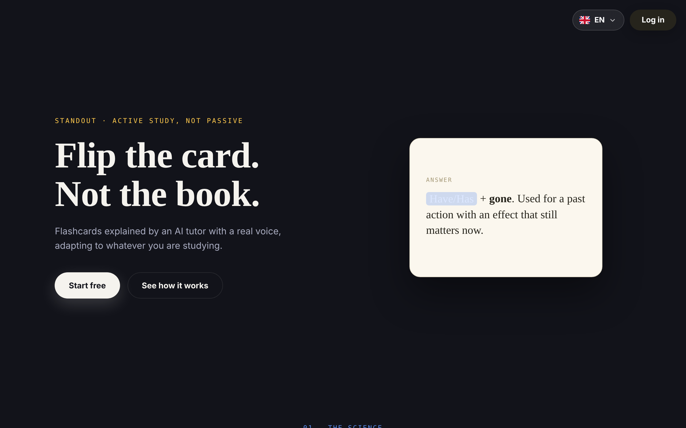
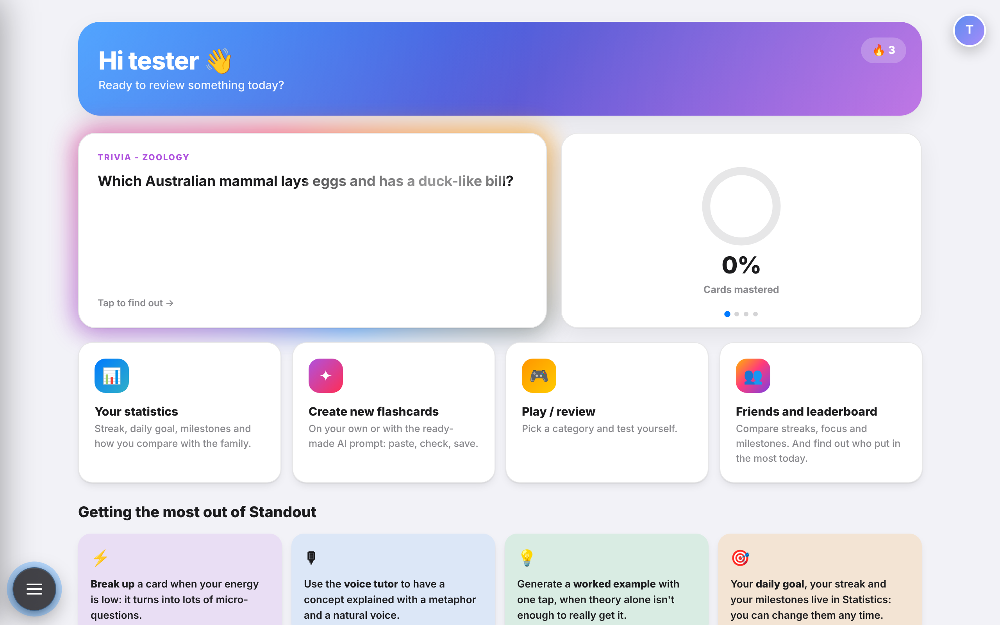
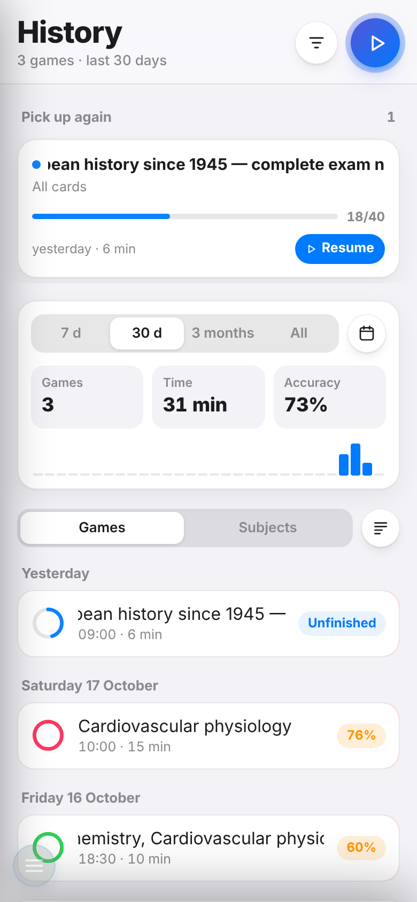
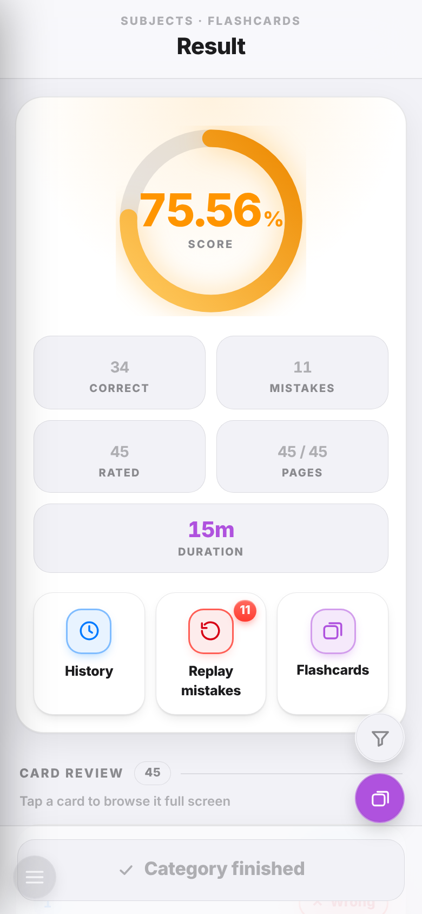
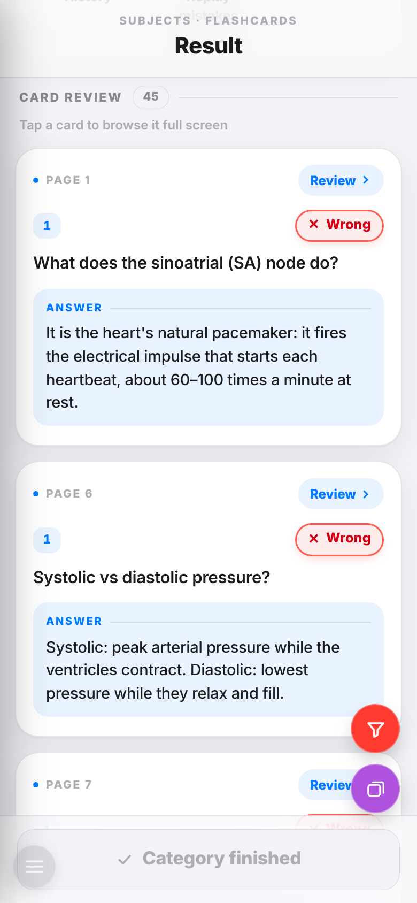
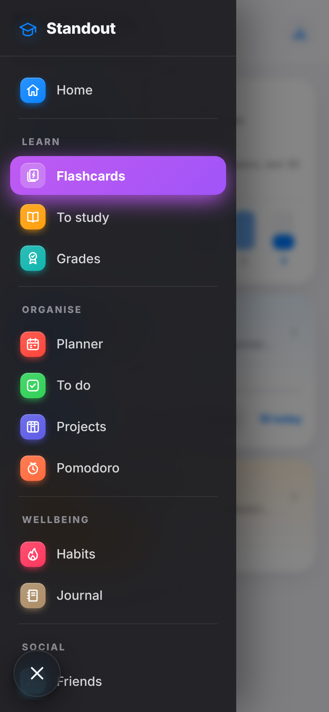

# Standout

**Active-recall flashcards with an AI tutor, plus a complete personal-productivity suite — designed and built by one person, from the database up, without frameworks.**

🌐 **Live:** [nisama.altervista.org](https://nisama.altervista.org) · 🇮🇹 🇬🇧 available in Italian and English · 📱 installable as a PWA



---

## Why I built it

Most students study by rereading and highlighting. It *feels* productive, but decades of cognitive-psychology research say otherwise: in Dunlosky et al.'s 2013 review of ten common study techniques, only two earned a "high utility" rating — **practice testing** (active recall) and **spaced practice**. Roediger & Karpicke (2006) showed that students who tested themselves forgot far less than students who reread the same material.

Standout turns those two findings into a tool. You study with flashcards, you answer *before* seeing the solution, and the app tracks what you got wrong so you can come back to it. AI is there to remove the friction: generating cards from your own notes, explaining a card out loud, or breaking a hard card into smaller questions when your energy is low.

It started as the tool I needed for my own Computer Engineering exams, and grew into a full platform.

---

## Screenshots

| Dashboard | History | Results |
|---|---|---|
|  |  |  |

| Mistakes review | Navigation |
|---|---|
|  |  |

---

## What it does

### 🧠 Learning
- **Flashcards for any subject** — nested decks, parent/child cards (a concept with its sub-cases), images, recorded audio, and LaTeX formulas rendered with MathJax.
- **Language courses** — a dedicated vocabulary mode with word, translation, meaning and example sentences, for any language pair.
- **Game modes and full history** — every session is saved; unfinished games can be resumed months later from exactly where you left off; results show score, accuracy, time and a card-by-card review, with a one-tap "review only my mistakes".
- **Statistics** — streaks, daily goals, milestones and accuracy over time.

### ✨ AI features
- **Cards from your documents** — upload a long PDF or notes; the text is split on paragraph boundaries, processed as a background job, and you review the extracted concepts *before* any card is written (so you never pay for cards you don't want).
- **Voice tutor** — any card can be explained out loud with natural text-to-speech, using metaphors generated for that specific card.
- **"Break it up"** — turns one heavy card into several micro-questions.
- **Worked example in one tap** — a practical example tailored to the card.
- **Credit system** — an append-only ledger records every AI call (model, tokens, cost); users are only charged for work actually delivered, and an admin dashboard shows real cost per feature.

### 📅 Productivity
- **Planner** with day/week/month views, routines, priorities, weather, places on a map and **Google Calendar sync**.
- **To do / to buy / to study** lists, **habit tracker** with streaks and milestones, **journal**, **projects**, a **Pomodoro timer** linked to projects, and a **university grades** tracker.

### 👥 Social
- Friends, friend requests, notifications, and side-by-side comparison of streaks and focus time.

---

## Tech stack

| Layer | Technology |
|---|---|
| Backend | PHP 8 (procedural, no framework) |
| Database | MySQL 8 — 87 tables |
| Frontend | HTML, CSS and vanilla JavaScript — no framework, no build step |
| AI | Google Gemini (text generation), Google Cloud Text-to-Speech |
| Integrations | Google Calendar (OAuth 2.0), Google Places / Maps, weather API |
| Web app | Progressive Web App: manifest, service worker, offline page |
| Hosting | Apache with `.htaccess` routing (shared hosting today, VPS migration planned) |

**By the numbers:** ~90,000 lines of PHP, ~26,000 of JavaScript, ~24,000 of CSS · 87 database tables · 3,500+ translation keys per language.

---

## Engineering highlights

These are the parts I'm most proud of, because they solve real problems rather than just adding features.

**Security by default.** A shared security layer (`lib/security_core.php`) gives every page the same tools: typed input validation (`sec_int`, `sec_str`, `sec_enum`, `sec_date`…), prepared statements for queries, CSRF tokens and per-user rate limits on writes, and ownership checks before a row is changed or deleted; important events go to an audit log; a Content-Security-Policy header limits where scripts can load from. Only `public/` is reachable from the web — `lib/`, `lang/`, `docs/` and `tools/` return 403.

**A resumable AI job engine.** Long documents can't be processed in one HTTP request on shared hosting (no cron, strict time limits). So the work is split into steps stored in the database and advanced one at a time: it survives page reloads, resumes after failures, splits batches that come back truncated (8 → 4 → 2), and stops itself with a circuit breaker if the provider is down instead of burning retries. The database itself guarantees *one active job per user* (a generated column with a unique index) and makes double-charging impossible (`UNIQUE(step_id, reason)`), so neither rule can be bypassed by opening two tabs.

**Performance where it matters.** The history page loads its data in separate requests, so the first screen appears immediately even with years of games behind it. The results page renders the score animation first, then cards 1, 2, 3, then in batches of 10 — card images only download when their card is inserted. Repeated per-card queries were replaced with batched ones (two queries instead of fifty).

**Internationalisation built for two clients.** All interface text lives in `lang/*.json` (not in PHP), so the same files can be read by the planned React Native app. The language is chosen from the URL, the session, the user's profile, a cookie or the browser, in that order; a user's choice is saved to their profile and follows them across devices.

**A structure that survived a big migration.** The project began as a single flat folder. I reorganised it into `public/` / `lib/` / `lang/` / `docs/` / `tools/` and moved the site to a new address without breaking a single old link: every legacy URL (bookmarks, installed PWAs, Google's OAuth callback, file paths stored inside users' cards) is redirected or aliased in `.htaccess`.

**Home-made static checks.** `tools/` contains small scripts written after real bugs: one compares the columns used in SQL queries with the real schema, one verifies each page against the security checklist, one finds scripts the CSP would block, and one lists any user-facing string that isn't translated yet.

---

## Project structure

```
.htaccess          routes every request into public/, keeps legacy URLs working
public/            the only folder reachable from the web
  fc/              flashcards: decks, editor, games, history, results, stats
  ai/              AI features, job engine, credits
  planner/         planner, to-do, habits, journal, Google Calendar
  projects/        projects and Pomodoro
  social/          friends and notifications
  account/  api/   login, registration, small JSON endpoints
  partials/        shared components (sidebar, language picker, notifications)
  _assets/         icons, shared JS/CSS, vendored libraries
lib/               core logic: security layer, auth, i18n, flashcard engine
lang/              it.json, en.json
sql/schema.sql     database structure (no data)
docs/              design documents (in Italian)
tools/             static-analysis scripts
media/             user uploads (created at runtime, not in git)
```

---

## Running it locally

**Requirements:** PHP 8.0+ with `mysqli`, MySQL 8.0+, Apache with `mod_rewrite`.

```bash
git clone https://github.com/nico-1717/standout.git
cd standout

# 1. Database
mysql -u root -p -e "CREATE DATABASE standout CHARACTER SET utf8mb4"
mysql -u root -p standout < sql/schema.sql

# 2. Configuration
cp lib/config.example.php lib/config.php
#    then edit lib/config.php: database credentials and (optionally) API keys

# 3. Serve the project root with Apache (AllowOverride All), then open
#    http://localhost/ and create an account.
```

The core study features work without any API key; the AI, text-to-speech, maps and Google Calendar features need their respective keys.

---

## Roadmap

- **Move to a VPS** (Hetzner + Cloudflare + R2 object storage), with a real cron worker for AI jobs.
- **A clean JSON API** shared by the website and a **React Native app** (iOS + Android) with offline mode and push notifications.
- **A deck marketplace** where users can publish and buy ready-made decks.

---

## About me

I'm Nico, a Computer Engineering student at Politecnico di Milano, aiming for a master's in Artificial Intelligence. Before university I worked in accounting and built internal tools in VBA and React.

I designed Standout end to end — product, database, backend, frontend and deployment — and I use it every day to study. AI coding assistants were part of my workflow as pair programmers; the product decisions, architecture, integration and testing are my own.

📫 *[LinkedIn](https://www.linkedin.com/in/your-profile) · [Email](mailto:you@example.com)*
